# Adrift — 16-Voice BBD Resonator Synthesizer for M-VAVE FM-1

**Adrift** is custom synthesizer firmware that transforms the pocket-sized **M-VAVE FM-1** into a **16-voice polyphonic physical-modeling and virtual-analog instrument**. Built around key-tracked **Bucket Brigade Device (BBD) resonators**, morphing analog-style oscillators, **6 multi-timbral Voice Groups**, per-group arpeggiators, and a **4-stage stereo studio effects bus**, Adrift crafts acoustic guitars, bowed strings, hollow woodwinds, buzzing sitars, evolving granular clouds, and massive 16-voice unison leads.

**[Play Adrift Live in Your Browser & Flash Your FM-1](https://romainguy.github.io/adrift/)**

- **Try Before Flashing**: Play all 24 factory presets directly on the **[Adrift Website](https://romainguy.github.io/adrift/)** using your mouse, touch screen, computer keyboard, or USB MIDI controller.
- **One-Click USB Install**: Flash Adrift straight onto your M-VAVE FM-1 from Chrome, Edge, Brave, or Opera in ~15 seconds — no command line or drivers required.
- **100% Reversible**: Restore the official M-VAVE factory firmware (`FM-1.fwsc`) at any time from the same browser installer.

| Exciter (`EXC`) | BBD Resonator (`BBD`) | 16-Voice Soundstage (`HOME`) | Shimmer Reverb (`FX`) |
| :---: | :---: | :---: | :---: |
| 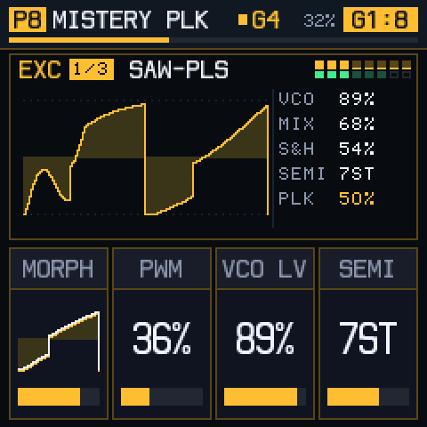 | 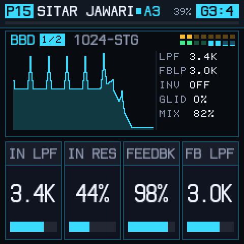 | 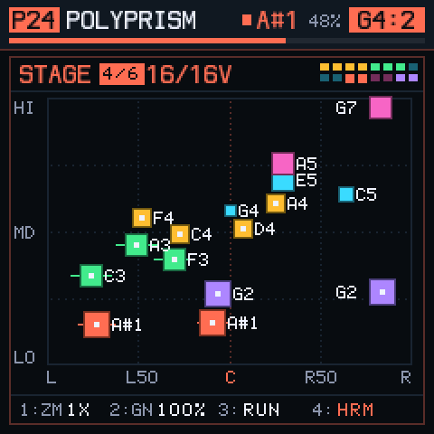 | 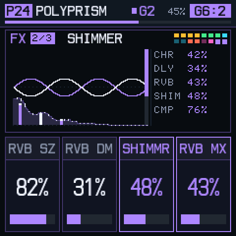 |

---

## Installing Adrift on Your M-VAVE FM-1

1. Connect your **M-VAVE FM-1** to your computer (macOS, Windows, Linux) or Android device using a **USB data cable**, and switch the synth **ON**.
2. Close any music software or DAW that might already be holding the FM-1's USB-MIDI port open.
3. Open **[romainguy.github.io/adrift/#install](https://romainguy.github.io/adrift/#install)** in a WebMIDI-capable browser (**Google Chrome**, **Microsoft Edge**, **Brave**, or **Opera**).
4. Click **Connect & Flash Adrift** and allow **MIDI SysEx** access when your browser asks.
5. Keep the cable plugged in for ~15 seconds while the installer verifies the package, writes changed blocks, and restarts your FM-1 directly into Adrift.

> **Want to switch back later?** Expand *Restore Official M-VAVE Factory Firmware* on the [Install section of the website](https://romainguy.github.io/adrift/#install) to flash the unmodified stock M-VAVE `FM-1.fwsc` package whenever you like.

---

## How Adrift Makes Sound

Instead of relying only on standard subtractive oscillators and filters, each of Adrift's **16 voices** sends an oscillator-and-noise **Exciter** into a tuned **1024-stage Bucket Brigade Device (BBD) delay loop** that resonates at the exact pitch of the note you play:

```text
[Morphing Oscillator + Pluck + Noise] ──> [Env 1 Contour] ──> [12 dB Resonant LPF] ──┬── (Dry Synth Path) ─────────────────────┐
                                         (Delay + Loop)                              │                                         ▼
                                                                                     └──> (+) ──> [Key-Tracked BBD] ──> [Dry / Wet] ──> [Env 2 Gate] ──> [Stereo FX Bus]
                                                                                           ▲      (String / Pipe Body)                   (+ Drone)       (Chorus · Delay ·
                                                                                           └──── [Invert · Dispersion · Feedback LPF] ◄──────┘           Shimmer · Comp)
```

1. **Exciter (`EXC`)** — Generates the raw energy that plucks, strikes, bows, or blows into the resonator: a continuously morphing analog waveform (**Sine → Triangle → Saw → Pulse** with PWM), a crisp **Pluck** transient with `-1 oct` sub-oscillator, white or stepped sample-and-hold noise, and warm **ACB Drift**.
2. **Exciter Contour (`ENV1`)** — Shapes what enters the resonator. Short snappy decays pluck strings and bars; slow attacks bow cellos and pads; **Onset Delay** (`0–2 s`) staggers multi-group chord strums; **Loop Mode** (`A-D` / `D-A-D`) creates self-repeating polyrhythms and granular textures while a key is held.
3. **Input Filter & BBD Resonator (`BBD`)** — A 12 dB/oct resonant low-pass filter warms the exciter before it enters the key-tracked BBD loop. Raising **Feedback** turns short woody plucks into endlessly singing strings (and self-oscillates past `100%`), **Invert** flips loop phase for hollow clarinet/flute-like odd harmonics, and **Dispersion** adds bell, sitar, and metal bar stiffness.
4. **Output Gate & Modulation (`ENV2` & `MOD`)** — **Envelope 2** sits *after* the resonator so it can cleanly silence runaway feedback on key release — or sustain forever with hands-free **Drone Hold**. **Three independent LFOs** per Voice Group plus Mod Wheel (`CC1`) animate pitch, wave morph, filter, feedback, stereo pan, and envelope times.
5. **Master Stereo FX Bus (`FX`)** — All 16 voices flow through stereo **Dimension Chorus**, tempo-syncable **Ping-Pong Delay**, lush **Octave Shimmer Reverb**, and a punchy **Parallel Bus Compressor** with soft-knee limiting.

---

## Playing & Editing on the Hardware

### Two Simple Principles

- **Knobs `1`–`4` always match the 4 cards at the bottom of the screen.** Turn any of the four numbered knobs on the right to adjust the parameter directly in that column.
- **Press an active screen button again to flip subpages.** Screens with more than four controls show a badge like `EXC 1/3` or `FX 2/3` — press the same button again to cycle through `1/3 → 2/3 → 3/3`.

### Front-Panel Control Map

Because Adrift repurposes the M-VAVE FM-1's physical panel for BBD physical modeling, several buttons take on new musical roles:

| FM-1 Control | Adrift Role | What It Does |
| :--- | :--- | :--- |
| **Master Knob** | **Master Volume** | Controls overall headphone and line-out level. |
| **`SELECT` Knob** | **Voice Group (`G1`–`G6`)** | Selects which of the 6 color-coded Voice Groups you are playing on the built-in keyboard and editing on screen. |
| **`PRESETS` Knob** | **Preset Browser** | Scrolls with live audio preview through `INIT SYNTH`, `INIT GROUP`, Factory **`P1`–`P24`**, and User **`U1`–`U24`**. Press **`OCT+`** to keep or **`OCT-`** to cancel and restore your previous sound. |
| **`ALGORITHM` Knob** | **Scale Browser** | Chooses from **16 musical scales** (`KNOB 1` sets root note `C`–`B`). In any non-chromatic scale, the white keys step cleanly through in-key notes so every run stays in key. |
| **`KNOB 1`–`KNOB 4`** | **Screen Parameters 1–4** | Edits the 4 parameter cards shown along the bottom of the current screen. |
| **`SCL` Button** | **`EXC` · Exciter (`1/3–3/3`)** | Waveform morph, PWM, VCO level, coarse/fine tune, wave/noise mix, S&H clock, Pluck + sub-osc, analog drift, and VCO keytracking. |
| **`ENV` Button** | **`ENV1` · Exciter Env (`1/2–2/2`)** | Pre-resonator DADSR contour, Onset Delay (`0–2 s`), velocity sensitivity, `A-D` / `D-A-D` envelope looping, and time range (`SHORT` `250 ms` / `NORM` `5–10 s` / `LONG` `25 s`). |
| **`LFO` Button** | **`BBD` · Resonator (`1/2–2/2`)** | Input filter cutoff & resonance, BBD feedback (`0–115%`), loop damping (`FB LPF`), hollow pipe polarity `Invert`, glide, dry/wet mix, and all-pass `Dispersion`. |
| **`EDIT` Button** | **`ENV2` · Output Env (`1/2–2/2`)** | Post-resonator ADSR contour, onset delay, velocity sensitivity, and hands-free **Drone Hold**. |
| **`GLO` Button** | **`MOD` · 3 LFOs & MW (`1/4–4/4`)** | Configures **LFO 1**, **LFO 2**, **LFO 3** (wave, rate, depth, and 22+ destinations), and Mod Wheel (`CC1`) depth. |
| **`SEQ` Button** | **`GRP` · Voice Groups (`1/2–2/2`)** | Allocates the 16 hardware voices across **`G1`–`G6`**, sets voice mode (`POLY`, `UNISON`, `SUPER`), stereo spread, detune, MIDI channel (`CH 1`–`16`), pan, transpose, and level. |
| **`ARP` Button** | **`ARP` · Arpeggiator (`1/2–2/2`)** | Per-group arpeggiator with 10 patterns, `1–4` octaves, BPM (or auto-locked external MIDI Clock), gate, velocity, **Latch**, **Swing**, and **Ratchet** repeats (`2X`–`4X`, random). |
| **`FX` Button** | **`FX` · Master FX (`1/3–3/3`)** | Stereo Dimension Chorus, Ping-Pong Delay, Octave Shimmer Reverb, and Parallel Bus Compressor with live gain-reduction meter. |
| **`HOME` Button** | **6 Live Visualizers (`1/6–6/6`)** | Cycles **Oscilloscope**, **Stereo Vectorscope**, **FFT Spectrum + Waterfall**, **16-Voice Stereo Soundstage**, **16-Voice Telemetry**, and **6-Group Performance Dashboard**. |
| **`SAVE` Button** | **Save User Preset (`U1`–`U24`)** | Saves all 6 Voice Groups, Master FX, and a custom 12-character patch name to permanent flash memory (`OCT+` saves, `OCT-` cancels). |
| **`PLAY` Button** | **Panic (All Sound Off)** | Immediately silences all held notes, drones, BBD feedback loops, and reverb/delay tails. |
| **`OCT -` / `OCT +`** | **Octave / Cancel & Confirm** | Shifts the 27-key keyboard down or up by octaves — or acts as **Cancel (`OCT-`)** and **Confirm (`OCT+`)** inside the Preset, Scale, and Save screens. |

---

### Screen Tour

#### Sound Shaping (`EXC`, `ENV1`, `BBD`, `ENV2`, `MOD`)

| `EXC 2/3` · Pluck & Noise | `ENV1 2/2` · Delay & Loop | `BBD 2/2` · Invert & Dispersion | `MOD 1/4` · 3× LFO Overlay |
| :---: | :---: | :---: | :---: |
| 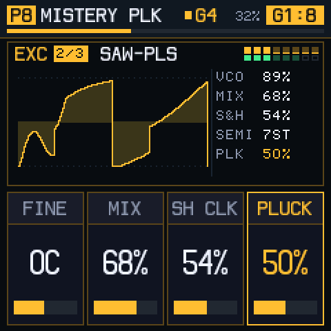 | 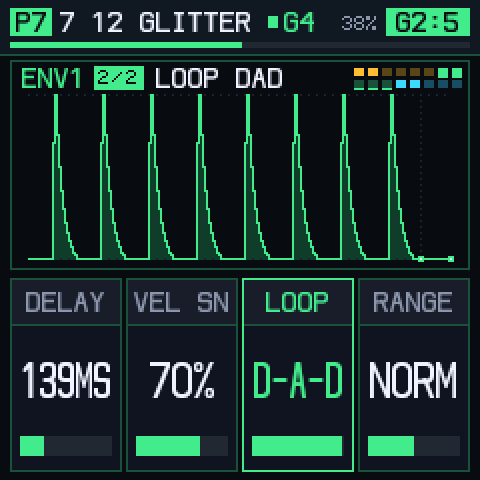 | 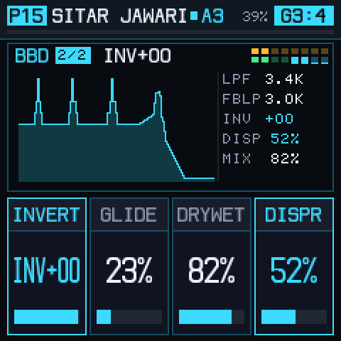 | 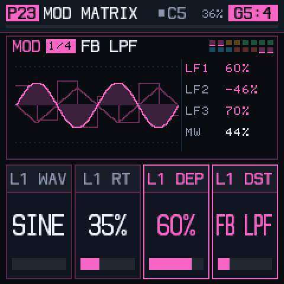 |

#### 6 Voice Groups, Arpeggiator & Studio FX (`GRP`, `ARP`, `FX`)

Adrift's 16 voices are shared across **6 independent Voice Groups (`G1`–`G6`)**, each with its own signature OLED color (**Gold**, **Emerald**, **Cyan**, **Coral**, **Magenta**, **Violet**):
- **Layer Sounds Together**: Assign multiple groups to **MIDI Channel 1** (for example, a plucked acoustic body on `G1` + a delayed octave shimmer on `G2`) so a single key press triggers an evolving multi-layered instrument.
- **Multi-Timbral Splits & Sequencers**: Keep `G1`–`G6` on **MIDI Channels 1–6** to drive up to 6 distinct synth parts at once from an external sequencer or DAW.
- **Massive Unison (`UNISON` & `SUPER`)**: Stack a group's voices onto every note with symmetrical stereo **Spread** and **Detune** — either with an independent BBD resonator per voice (`UNISON`) or all oscillators slammed into a single shared resonator (`SUPER`).

| `GRP 1/2` · 6-Group Matrix | `ARP 1/2` · Pattern & Tempo | `FX 1/3` · Chorus & Delay | `FX 3/3` · Bus Compressor |
| :---: | :---: | :---: | :---: |
| 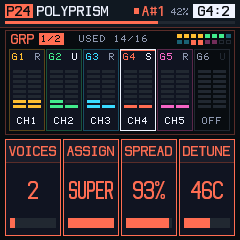 | 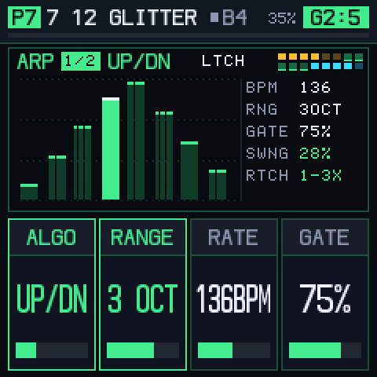 | 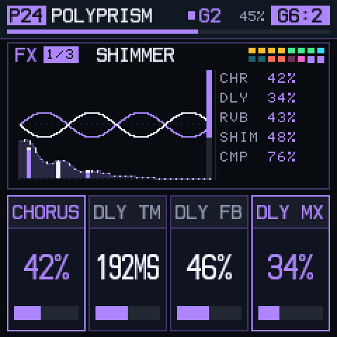 | 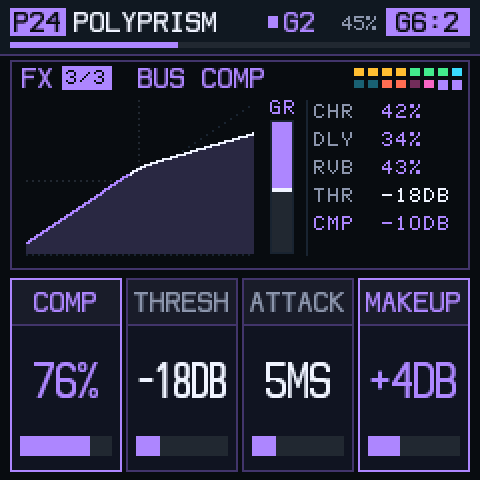 |

#### Presets, Scales, Saving & Live Visualizers (`PRESETS`, `SCALES`, `SAVE`, `HOME`)

- **Single-Group Patch Import**: In the **Preset Browser** (`PRESETS` knob), turn **`KNOB 2` (`2:MD`)** from `FULL` to `GRP` and use **`KNOB 3` (`3:SR`)** to import *just one Voice Group* from any Factory or User preset into your current patch — great for mixing and matching layers!
- **16 Performance Scales**: Turn **`ALGORITHM`** to lock the white keys to *Major*, *Natural Minor*, *Minor/Major Pentatonic*, *Blues*, *Dorian*, *Phrygian*, *Lydian*, *Mixolydian*, *Harmonic/Melodic Minor*, *Phrygian Dominant*, *Hirajoshi*, or *Whole Tone* in any root key (`KNOB 1`).
- **Visualizers**: By pressing **HOME**, you can cycle through the various visualizers offered by Adrift (oscilloscope, stereo stage, etc.). On each visualizer, use the knobs to zoom, set the gain, or set visualizer-specific options.

| Preset Browser (`P1–24 · U1–24`) | 16-Scale Browser | Save User Preset (`U1–U24`) | `HOME` Spectrum & Waterfall |
| :---: | :---: | :---: | :---: |
| 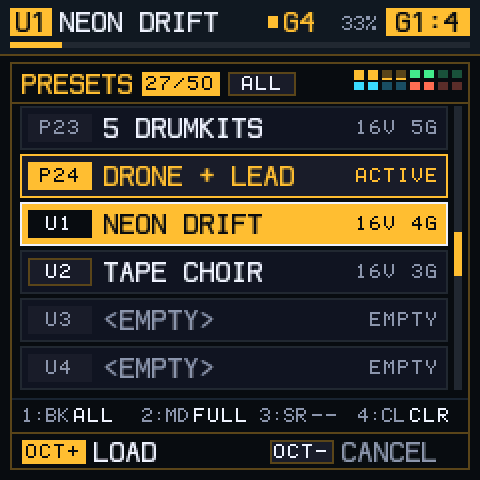 | 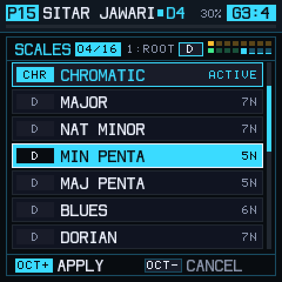 | 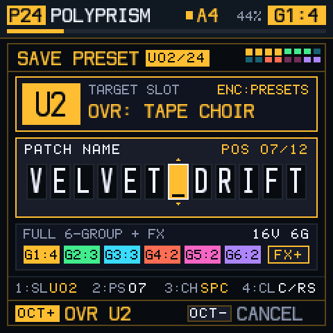 | 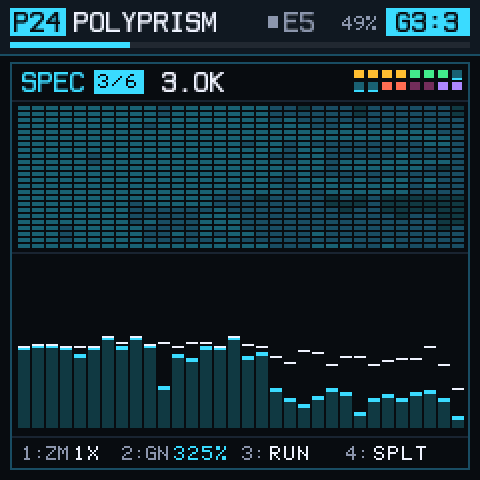 |

---

## 24 Factory Presets

You can audition every factory preset right now in the **[Online Emulator](https://romainguy.github.io/adrift/#presets)**:

| Slot | Name | Layout | Sound Character |
| :--- | :--- | :--- | :--- |
| **`P01`** | **Acoustic Guitar** | `3V · 1 Group` | Warm plucked nylon-and-steel guitar string with 13 free voices ready for extra layers. |
| **`P02`** | **Bowed Cello Duo** | `14V · 2 Groups` | Expressive rosined cello body on `G1` paired with a delayed `+1 oct` wooden harmonic bloom on `G2`. |
| **`P03`** | **Chord Strummer** | `16V · 4 Groups` | Press one key to strum a staggered 4-string acoustic chord (Root, 5th, Octave, and 12th). |
| **`P04`** | **Auto Feedback** | `12V · 2 Groups` | Self-oscillating BBD loop singing on the edge of runaway analog feedback over a detuned sub-octave. |
| **`P05`** | **Slowpad** | `16V · 2 Groups` | Wide PWM BBD string ensemble melting into Dimension Chorus, Ping-Pong Delay, and Shimmer Reverb. |
| **`P06`** | **Melancholy Bath** | `14V · 2 Groups` | Tape-warbled felted keys shadowed by a delayed inverted-phase octave ghost halo. |
| **`P07`** | **7 · 12 Glitter** | `16V · 3 Groups` | Crisp harp pluck followed by looping fifth (`+7 ST`) and octave (`+12 ST`) envelope sparkles. |
| **`P08`** | **Mystery Pluck** | `14V · 2 Groups` | Stepped sample-and-hold modal bell pluck over a hollow inverted sub-octave pipe. |
| **`P09`** | **Random Pluck** | `16V · 2 Groups` | Every note lands with a fresh wave shape and filter color via per-voice sample & hold. |
| **`P10`** | **7th Overdub** | `16V · 3 Groups` | Warm electric tine keys that swell into a lush minor-7th chord as you hold notes down. |
| **`P11`** | **Granular Cloud** | `16V · 4 Groups` | Four asynchronous looping-envelope grain streams weaving fifths and octaves over a warm pad. |
| **`P12`** | **Into The Void** | `16V · 3 Groups` | Groaning iron resonators and hollow metal pipes anchored by a 4-voice unison sub bass. |
| **`P13`** | **Pulsing Poly-Gate** | `14V · 2 Groups` | Interlocking polyrhythms driven by looping `A-D` and `D-A-D` exciter envelopes an octave apart. |
| **`P14`** | **Hollow Flute** | `12V · 2 Groups` | Inverted-polarity cylindrical woodwind pipe with a breathy unison reed chiff on each attack. |
| **`P15`** | **Sitar Jawari** | `16V · 3 Groups` | Dispersive buzzing Jawari bridge with delayed sympathetic fifth and high Chikari octave strings. |
| **`P16`** | **Marimba Wood** | `14V · 2 Groups` | Hollow rosewood marimba bars kissed with a bright kalimba thumb-tine harmonic. |
| **`P17`** | **Glass Bowls** | `16V · 2 Groups` | Singing Tibetan glass bowls wrapped in a crystalline octave shimmer tail. |
| **`P18`** | **Clavinet Funk** | `12V · 2 Groups` | Snappy narrow-pulse funk clavinet with an upper-bridge key click for percussive riffs. |
| **`P19`** | **Super Bass** | `12V · 2 Groups` | Eight detuned oscillators driven into a single shared BBD resonator (`SUPER`), topped with a tight pluck. |
| **`P20`** | **16V Monster** | `16V · 1 Group` | All 16 hardware voices stacked into one massive stereo unison lead. |
| **`P21`** | **BBD Chorus Poly** | `16V · 2 Groups` | Lush 8-voice polysynth blending dry analog-style oscillators with warm BBD ensemble chorus. |
| **`P22`** | **Cathedral Pipe Organ** | `16V · 4 Groups` | Four-rank pipe organ stacking 16' Bourdon sub, 8' Principal, Nazard fifth, and 4' Clarion pipes. |
| **`P23`** | **5 Drumkits** | `16V · 5 Groups` | Physical-modeling percussion playable together on `Ch 1` or split across `MIDI Ch 1–4` (Kick, Snare, Sub, Clap, Hat). |
| **`P24`** | **Drone + Lead** | `16V · 4 Groups` | Expressive 8-voice bowed lead on `Ch 1` over hands-free `C3` & `G3` unison drones (`Ch 2–3`) and a pluck companion (`Ch 4`). |

---

## MIDI & External Gear Guide

Adrift responds simultaneously to **USB-MIDI** and the **3.5mm TRS MIDI IN** jack (`31,250` baud), routing incoming notes and controllers by MIDI channel (`CH 1`–`CH 16`) to matching Voice Groups (`G1`–`G6`):

- **Expressive Performance**: Velocity, 14-bit Pitch Bend, Aftertouch, Mod Wheel (`CC1`), Portamento (`CC5`), Group Volume (`CC7`), Sustain Pedal (`CC64`), Legato (`CC68`), Drone Hold (`CC69`), Unison Detune (`CC94`), All Sound Off (`CC120`), and All Notes Off (`CC123`).
- **Preset Recall**: Send **Program Change `0`–`23`** for Factory `P1`–`P24` and **`24`–`47`** for User `U1`–`U24` (or use Bank Select `CC0 = 1` + Program Change `0`–`23` for `U1`–`U24`).
- **Automatic MIDI Clock Sync (`24 PPQN`)**: Send MIDI Clock from your drum machine, groovebox, or DAW and Adrift automatically locks all 6 per-group Arpeggiators (`EXT` BPM, preserving Swing and `2X`/`3X`/`4X` Ratchets), resets to step 1 on MIDI `Start`, and switches Master Ping-Pong Delay time (`2:DLY TM`) into tempo-synced musical subdivisions (`1/32`, `1/16T`, `1/16`, `1/8T`, `1/16D`, `1/8`, `1/8D`, `1/4`). If clock stops, Adrift falls back to internal tempo after 2 seconds.

<details>
<summary><strong>Full MIDI CC Chart (Click to expand — or search interactively on the website)</strong></summary>

<br>

An interactive, searchable version of this table is available at **[romainguy.github.io/adrift/#midi](https://romainguy.github.io/adrift/#midi)**.

| Section | MIDI CC Assignments |
| :--- | :--- |
| **Performance & Presets** | `CC0` Bank Select (`0` = Factory, `1` = User) · `CC1` Mod Wheel · `CC5` Glide Time · `CC7` Group Level · `CC64` Sustain Pedal · `CC68` Legato (`0–63` Retrig, `64–127` Legato) · `CC69` Drone Hold · `CC94` Unison Detune · `CC120` All Sound Off · `CC121` Reset Controllers · `CC123` All Notes Off |
| **Exciter (`EXC`)** | `CC14`/`CC70` Wave Morph · `CC15` Pulse Width · `CC16` VCO Level · `CC17` Coarse Semi · `CC18` Fine Tune · `CC19` Wave/Noise Mix · `CC20` S&H Rate · `CC21` ACB Drift · `CC87` VCO Keytrack · `CC88` Pluck + Sub-Osc |
| **Envelope 1 (`ENV1`)** | `CC22` Onset Delay · `CC23` Attack · `CC24` Decay · `CC25` Sustain · `CC26` Release · `CC27` Velocity Sens · `CC28` Loop Mode · `CC39` Time Range (`SHORT` / `NORM` / `LONG`) |
| **Filter & Resonator (`BBD`)** | `CC74` Input LPF Cutoff · `CC71` Input Resonance · `CC75` BBD Feedback (`0–115%`) · `CC76` FB Damping LPF · `CC77` Polarity Invert · `CC78` Invert Pitch Comp · `CC79` Dry/Wet Mix · `CC89` All-Pass Dispersion |
| **Envelope 2 (`ENV2`)** | `CC73` Attack · `CC80` Decay · `CC81` Sustain · `CC72` Release · `CC82` Velocity Sens · `CC69` Drone Hold |
| **Modulation (`LFO 1–3`)** | **LFO 1**: `CC83` Wave, `CC84` Rate, `CC85` Depth, `CC86` Dest · **LFO 2**: `CC31` Wave, `CC32` Rate, `CC33` Depth, `CC34` Dest · **LFO 3**: `CC35` Wave, `CC36` Rate, `CC37` Depth, `CC38` Dest |
| **Arpeggiator (`ARP`)** | `CC102` Algorithm (`0–10`) · `CC103` Octave Range (`1–4`) · `CC104` Rate (`40–240 BPM`) · `CC105` Gate · `CC106` Velocity (`0` = Key, `1–127` = Fixed) · `CC107` Latch · `CC108` Swing · `CC109` Ratchet (`0–7`) |
| **Master Stereo FX (`FX`)** | `CC95`/`CC110` Chorus Mix · `CC111` Delay Time · `CC112` Delay Feedback · `CC113` Delay Mix · `CC114` Reverb Size · `CC115` Reverb Damping · `CC92`/`CC116` Octave Shimmer · `CC91`/`CC117` Reverb Mix · `CC118` Bus Comp Mix · `CC119` Comp Threshold · `CC29` Comp Attack · `CC30` Comp Makeup |

</details>

---

## Developer Quick Start

Adrift is a bare-metal dual-core C99 firmware for the M-VAVE FM-1's `JieLi AC791N` (`pi32v2`) SoC, built on [`hugelton/felucca-bsp`](external/felucca-bsp) with a `<1s` native macOS `SDL2` + `CoreMIDI` desktop simulator, cycle-accurate [`joakimeriksson/fm1-emu`](external/fm1-emu) verification, and a freestanding `clang` → `wasm32` WebAssembly build powering the [online emulator](https://romainguy.github.io/adrift/).

```sh
# 1. One-time environment verification / setup (macOS Apple Silicon)
./tools/setup_env.sh

# 2. Run automated DSP, MIDI, UI & User Preset verification suite
./build.sh test

# 3. Build & launch fast-iteration native macOS SDL2 + CoreMIDI simulator (<1s build)
./build.sh sdl
./build/sdl/adrift

# 4. Build flashable M-VAVE FM-1 hardware firmware package (build/fw/adrift.fwsc)
./build.sh fw

# 5. Boot actual pi32v2 .fwsc firmware in cycle-accurate AC791N hardware emulator (live audio + MIDI)
./build.sh emu

# 6. Run strict cycle-accurate 16-voice multi-group pi32v2 CPU & audio verification benchmark
./build.sh bench

# 7. Build static website, WebAssembly emulator & browser flasher bundle (build/web/)
./build.sh web

# 8. Build and publish the website to the gh-pages branch
./tools/deploy_gh_pages.sh
```

## License

MPL-2.0, see [LICENSE](./LICENSE).
